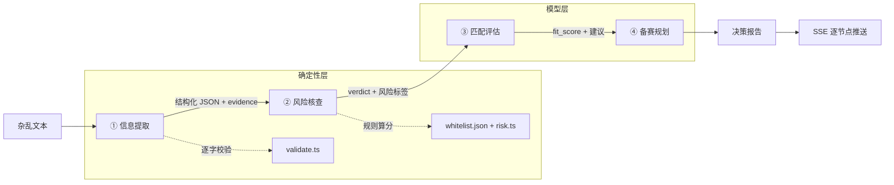

# 校园赛事雷达 · CampusRace Radar

> 一个面向大学生的赛事情报解析工具：把杂乱的群聊、公众号推文、网页通知，变成一份「能不能信、适不适合我、该怎么准备」的决策报告。

参赛项目 · 2026第九届传智杯全国大学生数智创新与AI应用大赛——AI创新应用挑战赛（Vibe Coding 赛项）


---

## 团队信息

| 项目 | 内容 |
|---|---|
| 参赛形式 | 个人参赛 |
| 作者 | xiaotian（GitHub [@ppppppig-ggg](https://github.com/ppppppig-ggg)） |
| 参赛赛道 | 2026第九届传智杯全国大学生数智创新与AI应用大赛——AI创新应用挑战赛 · Vibe Coding |
| 赛事官网 | [boxuegu.com/match](https://www.boxuegu.com/match/) |
| 分工 | 需求分析、产品设计、前后端开发、测试与文档由作者独立完成；开发过程使用 AI 编程助手，过程记录见 [`docs/prompt-log/`](docs/prompt-log/) |

## 它解决什么问题

大学生找比赛，信息散在竞赛群、公众号、官网、社交平台，口径还经常不一致：同一赛事三版通知、截止时间对不上、"野鸡赛事"混在里面、主办方挂个查无此会的协会名。人工逐条核对既慢又容易漏。

本工具把这段流程做成一条可视化的 AI 工作流：

```
杂乱文本 → ① 信息提取 → ② 风险核查 → ③ 匹配评估 → ④ 备赛规划 → 决策报告
```

## 四个 Agent 节点

| 节点 | 职责 | 输出 |
|---|---|---|
| ① 信息提取 Extractor | 把非结构化的推文/群聊/OCR 文本抽成结构化 JSON | 赛事名、主办方、时间线、赛道要求、奖项 |
| ② 风险核查 Fact-Checker | 比对官方白名单 + 识别风险信号 | verdict（绿/黄/红）、**五项核验清单**、扣分依据、核验动作 |
| ③ 匹配评估 Matchmaker | 赛事 × 个人画像 | 匹配分（技能/时间/目标/门槛按 40/30/20/10 由代码重算）、推荐档位、分项贡献 |
| ④ 备赛规划 Planner | 倒排工期 | 分阶段任务、里程碑、缓冲周；每条任务带负责人、截止、成果物与验收标准，可导出 `.ics` 日历 |

> 设计原则：**工具不判定赛事真假**，只提示风险与可执行的核验路径，结论由人复核。

这一版额外补齐的可核验细节：

- **冲突/未核验不判低风险**：命中白名单但有来源冲突，或关键字段缺失时，权威度最高只到 79。
- **空画像不硬凑分数**：专业、年级、技能、目标、每周投入都为空时，匹配分与建议显示「待补充」。
- **证据链可逐条看**：届次、主办方、报名入口、报名/提交截止、资格与提交物五项分别标注「已核对 / 有冲突 / 无来源 / 待核验」，并给出原文引用。
- **个人赛 / 团队赛分流**：识别参赛形式，个人赛不生成「组队 / 队友 / 分工」任务。
- **演示与实时不混淆**：演示模式顶部固定「演示回放」，节点耗时标注「回放」，并显示回放总时长；实时模式说明数据会发送至模型服务。
- **结论区固定免责声明**：来源、研判时间与「不判定赛事真伪」固定在报告底部，不随滚动消失。
- **计划可带走**：任务按所在周生成周一提醒，可一键导出 `.ics` 日历（精确截止仍以官方通知为准）。

## 快速开始

```bash
# 1. 安装依赖并启动
npm ci
npm run dev
```

- 前端：http://localhost:5173
- 后端：http://localhost:8787（`POST /api/analyze`，SSE 推流；`GET /api/health` 查看模式）

默认 `USE_MOCK=true`，无需 API Key。演示模式按四个预置样例分别回放对应结果，不调用外部模型；手动输入的自定义内容需要切到实时模式才会分析。完整的 10 分钟复现步骤见 [复现指南](docs/reproduction.md)。

## 架构



两条设计原则：

1. **判定归规则，解释归模型**——风险分数由 `server/rules/risk.ts` 算出，同样输入永远同样结果；模型只负责把结论翻译成可执行动作。
2. **模型输出必须过校验**——`evidence` 在原文里找不到的字段一律置 null，宁可留空也不编。

## 技术栈

| 层 | 选型 | 说明 |
|---|---|---|
| 前端 | Vite 8 + React 19 + TypeScript 7 | 无 UI 组件库，Tailwind 4 + 手写 CSS |
| 后端 | Node + Express 5 | 不引数据库，白名单用静态 JSON |
| 通信 | SSE（Server-Sent Events） | 单向推流，节点逐个点亮 |
| 模型 | OpenAI 兼容协议 | 通过 `LLM_BASE_URL` 与 `LLM_MODEL` 指向兼容服务 |

## 目录结构

```
campusrace-radar/
├─ server/
│  ├─ index.ts          # Express + SSE 入口，四节点串行编排
│  ├─ agents/           # 四个 Agent 各一个文件
│  ├─ prompts/          # 四个 System Prompt（与文档版本一致）
│  ├─ rules/
│  │  ├─ risk.ts        # 确定性风险规则（白名单、域名、风险与正向信号、分数上限）
│  │  ├─ verification.ts# 五项核验清单与证据状态
│  │  ├─ score.ts       # 匹配分 40/30/20/10 重算
│  │  ├─ time.ts        # 截止时间戳比较与剩余周数
│  │  └─ participation.ts # 个人赛 / 团队赛识别
│  ├─ llm.ts            # provider 无关的模型调用层（超时/重试/故障注入）
│  └─ validate.ts       # evidence 逐字校验、日期校验、冲突校验
├─ src/
│  ├─ components/       # 节点卡片、报告区、画像表单
│  ├─ lib/sse.ts        # SSE 流解析（纯函数）
│  ├─ lib/profile.ts    # 画像类型与解析
│  └─ lib/report.ts     # Markdown 决策报告导出
├─ data/
│  ├─ whitelist.json    # 官方赛事白名单（可扩展）
│  ├─ mock-run.json     # 正常赛事的演示回放
│  └─ mock-cases.json   # 群聊、可疑赛事、无效内容的回放
├─ eval/
│  ├─ cases.json        # 12 条评测用例
│  ├─ run.mjs           # 批量评测
│  ├─ fault.mjs         # 故障注入
│  └─ report.md         # 评测报告（生成物，已提交作证据）
├─ scripts/
│  └─ md2pdf.mjs        # Markdown → PDF（技术文档生成脚本）
└─ docs/
   ├─ defense-qa.md     # 答辩问答
   ├─ technical-document.md  # 参赛技术文档源稿
   ├─ video-script.md   # 视频分镜
   └─ prompt-log/       # 过程材料（截图/录屏/日志）
```

## 文档索引

| 文档 | 说明 |
|---|---|
| [开发过程日志](docs/prompt-log/process-log.md) | 按时间线记录需求、决策、踩坑与修复 |
| [答辩问答准备](docs/defense-qa.md) | 12 个可能被追问的问题与回答思路 |
| [演示视频脚本](docs/video-script.md) | 产品演示 + AI 协同过程的分镜表 |
| [评测报告](eval/report.md) | 12 条用例的逐项结果与准确率 |
| [技术设计说明](docs/technical-design.md) | 架构、意图控制、AI 代码约束、可复现性论证 |
| [参赛技术文档（提交版）](output/pdf/campusrace-technical-document.pdf) | 提交用 PDF，14 页，含参赛信息、需求、架构、AI 方案、测试部署、创新与展望；源稿见 [technical-document.md](docs/technical-document.md) |
| [技术设计 PDF](output/pdf/campusrace-technical-design.pdf) | 深入版技术设计说明，18 页（`node scripts/md2pdf.mjs docs/technical-design.md output/pdf/campusrace-technical-design.pdf` 重新生成） |
| [Prompt 链重建](docs/prompt-log/prompt-chain.md) | 三次核心迭代的交互过程（重建稿） |
| [提交检查清单](docs/submission-checklist.md) | 按评审要求逐项确认代码与材料 |
| [10 分钟复现指南](docs/reproduction.md) | Windows 环境安装、启动、演示与排错 |
| [产品演示动图](docs/prompt-log/demo.gif) | 四节点依次点亮到决策报告 |

## 过程材料

`docs/prompt-log/` 目录存放参赛证据材料：

- `demo.gif` —— 产品演示动图（预览用，不能替代 MP4）
- `video-final.mp4` —— 5–8 分钟、1080p 的演示视频，随大赛材料单独提交，仓库不重复存放
- `prompt-chain.md` / `process-log.md` —— 三次核心迭代的交互过程与开发日志（重建稿已标注材料性质，不冒充原始导出）

`process-log.md` 是开发过程回顾，不能代替 AI 工具导出的完整对话。不要用事后编写的摘要冒充原始 Prompt 记录。

## 评测

```bash
npm test                # 42 项：evidence/日期校验 + 分数重算/截止边界/冲突封顶/核验清单/日历
npm run test:validate   # 只跑 evidence 校验、置空路径、日期边界
npm run test:rules      # 只跑分数重算、截止边界、冲突封顶、空画像、参赛形式
npm run eval            # 批量跑 eval/cases.json，生成 eval/report.md
npm run eval:fault      # 故障注入：模型输出坏 JSON / 接口 500，验证优雅失败
```

仓库上次记录的结果（12 条用例，含诈骗、过期、冲突、注入、OCR 噪声等对抗样本）：

| 指标 | 数值 |
|---|---|
| 用例全通过率 | 100% |
| 单项检查通过率 | 100% |
| 单条延迟（中位） | 12.1s |

> 说明：测试集为自建，覆盖 12 类场景，**不代表真实世界的准确率**。评测的价值在于把「模型可能怎么坏」变成可重复执行的检查。
>
> 以上数字为当前代码重新运行的结果（`npm run eval`），与仓库中的 `eval/report.md` 一致。

## 开发进度

- [x] Day 0 · 项目骨架与工具链
- [x] Day 1 · SSE 假数据链路 + 看板动效
- [x] Day 2 · 接真模型 + 证据校验
- [x] Day 3 · 风险核查 / 匹配评估 / 备赛规划
- [x] Day 4 · 状态机与风险视觉
- [x] Day 5 · 评测与故障注入
- [x] Day 6 · 文档与演示视频
- [x] Day 7 · 按评审批注补齐：五项核验、匹配分重算、空画像暂停、个人/团队分流、固定免责声明、演示标识
- [ ] Day 8 · 真实匿名样本扩充、字段级准确率、移动端复核、最终视频与提交材料

## 开发约定

1. 一个对话只干一件事，改完就 `commit`
2. 每个功能块独立提交，标签 `v0.x`
3. 演示资料（截图、录屏）存 `docs/prompt-log/`
4. `.env` 永不入库

---

## License

仅供参赛与学习使用。
